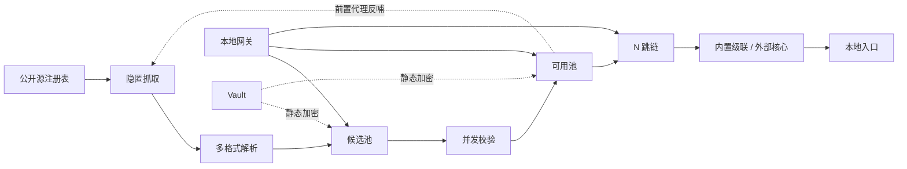

# 00 总体设计

## 1. 定位

anonchains 是一个**本地运行**的代理编排工具，把「采集 → 验证 → 组织 → 使用」串成闭环：

1. 从公开免费代理源低指纹地抓取列表；
2. 统一解析为 `ProxyNode`，去重后写入**候选池**；
3. 并发做握手、出口 IP 回显、匿名度与延迟校验，达标者升入**可用池**；
4. 按配置把可用节点拼成任意跳数的链，交由内置级联转发器或外部核心承载；
5. 通过可开关的本地网关 / 本地代理入口对外提供能力；
6. 周期复检、失效降级淘汰，并把可用节点反哺为采集前置代理。

交互为纯数字菜单的命令行界面：主菜单按数字进入子菜单，子菜单再按数字进入功能；同时提供非交互命令供脚本调用。

## 2. 设计目标

| 目标 | 落地方式 |
| --- | --- |
| 跳数任意可调 | `chain.hops` 无硬上限，仅 `>= 1`；`effective_connect_timeout()` 提供资源保护 |
| 类 proxychains 配置 | INI 主配置 + 环境变量覆盖 + 注释保留写回 + 热更新回滚 |
| 源覆盖广 | 内置 29 个公开源 + 自定义源清单 + 可选仓库检索发现 + 多格式解析器注册表 |
| 协议覆盖广 | 统一模型覆盖主流与新兴协议；内置转发处理原生协议，外部核心承载特殊协议 |
| 采集隐匿可选 | 1–4 级策略表，CLI 数字选择并落盘 |
| 双池闭环 | 候选池 / 可用池分离，增量复检、升降级、TTL 淘汰、前置反哺 |
| 网关可开关 | `gateway.enabled` 同时控制 REST 管理 API 与本地代理入口 |
| 敏感数据保护 | Vault 信封加密 + 日志脱敏 + 内存擦除 |
| 模块化与并行 | 四层单向依赖、注册表可插拔、asyncio 有界并发、SQLite 批量写入 |
| 跨平台 | 纯 Python + `aiohttp` / `asyncio`，无 `LD_PRELOAD`、无 Linux 专有机制 |

## 3. 范围边界（非目标）

- **不做**全网爬虫：只抓取公开免费列表，遵守 robots.txt / ToS / 限速；「覆盖尽可能多的来源」如实实现为可扩展的注册表与发现机制。
- **不做**攻击能力：不实现扫描攻击、未授权访问、凭证窃取、绕过付费或身份验证。
- **不做**链内自定义端到端加密：链内依赖各协议自带加密；Vault 只保护本地静态数据。公共免费代理无法充当可信解密端。
- **不做**绝对匿名保证：免费节点运营者、时序关联、DNS / WebRTC 泄漏、浏览器指纹仍可能关联身份。
- **不内置** sing-box / xray 二进制：由用户自备，缺失时优雅降级。
- **不实现**所有协议的 Python 原生转发：Python 无法安全完整实现的协议交给外部核心。

## 4. 术语表

| 术语 | 含义 |
| --- | --- |
| `ProxyNode` | 贯穿全链路的统一节点模型（协议、地址、凭证、测量值、评分） |
| 候选池 candidate pool | 解析后去重、尚未证明可用的节点集合 |
| 可用池 verified pool | 通过连通性 / 出口 IP / 匿名度 / 评分门槛的节点集合 |
| 前置代理 front proxy | 从可用池挑选、用于抓取源站的第一跳；冷启动直连 |
| 跳 hop | 链路中的一个代理节点；`hops` 即链长 |
| 隐匿等级 stealth level | 1–4 级采集行为策略，控制指纹与时序 |
| Vault | 本地静态敏感数据的信封加密设施 |
| 原生协议 native | Python 级联可直接转发的 http / https / socks4 / socks5 |
| 外部协议 external | 需 sing-box / xray 承载的协议（vless / vmess / ss / wireguard / tuic / hy2 等） |
| 本地入口 entry | 回环地址上的混合 SOCKS4/SOCKS5/HTTP CONNECT 监听 |
| 网关 gateway | REST 管理 API + 本地入口的总开关与生命周期 |
| 稳定键 `stable_key()` | 由协议 / 主机 / 端口 / 凭证规范化摘要生成的去重主键 |

## 5. 用户已确认的四项约束

1. 链路以**内置转发为主**，外部核心仅适配 Python 无法原生实现的特殊协议。
2. 网关**同时**提供管理能力（REST）与本地代理入口（SOCKS/HTTP）。
3. 加密**聚焦本地静态数据保护**，链内依赖各协议自带加密。
4. **跨平台**运行，允许引入依赖（不使用平台专有 hook）。

## 6. 能力一览

## 7. 首次使用路径

1. 安装依赖（见 [11](11-installation.md)）；
2. `python -m anonchains` 进入主菜单；
3. `7 -> 2` 初始化 Vault（设置主口令）；
4. `6 -> 1..4` 选择隐匿等级（默认 2）；
5. `1 -> 1` 抓取全部启用源；`3 -> 2` 跑完整闭环；
6. `2 -> 2` 查看可用池；`4 -> 2` 组链；`4 -> 5` 启动本地入口；
7. 需要 REST 时 `5 -> 4` 打开配置开关或 `5 -> 2` 临时启动。

所有状态查询、配置查看、菜单导航均可在**完全离线**状态完成；仅抓取、校验、源发现需要网络。
