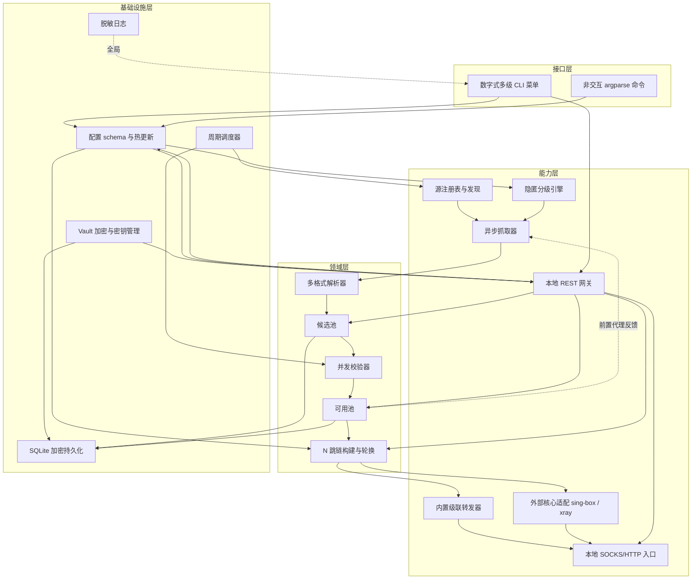

# 01 分层架构

## 1. 四层结构

依赖**自上而下单向流动**；横切能力（配置、Vault、日志、调度、持久化）由基础设施层提供。`anonchains/cli/app.py` 的 `AppContext` 是唯一的组装根（composition root），构造时不产生任何网络访问，因此 `status`、菜单、配置查看全部离线可用。

## 2. 目录与职责

| 包 | 主要文件 | 职责 |
| --- | --- | --- |
| `anonchains/cli/` | `app.py`、`menus.py`、`commands.py` | 组装根、菜单图、动作实现、非交互命令 |
| `anonchains/config/` | `schema.py`、`loader.py` | 强类型配置模型、INI 解析、环境变量覆盖、热更新、注释保留写回 |
| `anonchains/models/` | `proxy_node.py` | `Protocol` / `Anonymity` / `ProxyNode` 统一领域模型 |
| `anonchains/utils/` | `net.py`、`concurrency.py`、`hashing.py` | 地址解析、有界并发/限速/退避、稳定摘要 |
| `anonchains/logging_conf.py` | — | 统一日志、`RedactingFilter`、采样限流 |
| `anonchains/crypto/` | `kdf.py`、`cipher.py`、`vault.py`、`redaction.py` | KDF、AEAD 信封、Vault 生命周期、脱敏与擦除 |
| `anonchains/sources/` | `registry.py`、`discovery.py` | 源清单加载/覆盖/开关、可选仓库检索发现 |
| `anonchains/stealth/` | `levels.py`、`ua_pool.py`、`fingerprint.py` | 1–4 级策略表、UA 池、请求画像与时序抖动 |
| `anonchains/fetcher/` | `session.py`、`crawler.py` | 共享会话、robots/ETag、限速退避、前置反哺、并发抓取 |
| `anonchains/parser/` | `base.py`、`plain.py`、`json_parser.py`、`clash_yaml.py`、`subscription.py`、`detector.py` | 解析器注册表、格式探测、统一产出 `ProxyNode` |
| `anonchains/validator/` | `probes.py`、`anonymity.py`、`batch.py` | 原生握手探针、出口 IP / 匿名度 / 评分、并发批量校验 |
| `anonchains/pools/` | `store.py`、`candidate_pool.py`、`verified_pool.py` | SQLite WAL 持久化、双池 CRUD、前置节点选取 |
| `anonchains/chain/` | `builder.py`、`rotation.py` | 任意跳数组装、四种轮换、O(1) 指针 |
| `anonchains/forwarder/` | `cascade.py`、`local_server.py` | Python N 跳级联、本地混合入口 |
| `anonchains/core_adapter/` | `node_outbound.py`、`config_gen.py`、`process.py` | 协议字段映射、detour / dialerProxy 配置生成、进程生命周期 |
| `anonchains/gateway/` | `auth.py`、`api.py`、`server.py` | token 鉴权、REST 路由、启停与配置开关 |
| `anonchains/scheduler/` | `jobs.py` | 周期抓取 / 增量复检 / 失效淘汰 / 链轮换 |

## 3. 两条流水线与一个闭环

### 采集流水线

`SourceRegistry` → `Crawler`（`StealthPolicy` 控制请求画像、限速、抖动、ETag、robots、重试）→ `parse_payload()`（`detector` 嗅探并分派注册解析器）→ 私有/保留地址过滤 → `CandidatePool.add()`（`stable_key()` 去重）。

### 消费流水线

`Scheduler.run_once()` 收集 TTL 到期节点 → `Validator.validate_many()` 并发握手 + echo → `Validator.apply()` 更新评分/匿名度/统计 → 阈值判定 promote / demote / drop → `VerifiedPool` → `ChainBuilder` / `ChainRotator` → `cascade_connect()` 或 `generate_singbox()/generate_xray()` → `LocalEntryServer`。

### 反馈闭环

`VerifiedPool.front_pick()` 从可用池挑选高分原生 HTTP/HTTPS 节点作为抓取前置；`FetchSession` 冷启动直连，有可用节点后自动切池，并排除与当前源同主机的节点以避免自引用。该闭环降低采集端 IP 暴露，但不改变「公开列表 + 限速」的合规边界。

## 4. 关键技术决策

| 决策 | 理由 | 代价 / 限制 |
| --- | --- | --- |
| 单一 `ProxyNode` 模型 | 消除格式转换债，统一去重与评分 | 新增字段需同步解析/存储/加密/文档 |
| 内置 Python 级联 + 外部核心适配 | 跨平台、无 `LD_PRELOAD`；特殊协议不重复造轮子 | HTTPS 跳必须最后一跳；外部核心需用户自备 |
| 隐匿等级参数化策略表 | 一个数字切换全部行为，无散落分支 | 高等级显著降低吞吐 |
| SQLite + Vault 封印敏感列 | 索引去重与增量查询高效，静态数据加密 | 非敏感列明文（设计如此，便于查询） |
| 共享 `aiohttp` 会话 + 有界信号量 | 统一超时/重试/代理装配，连接复用 | 出口 RTT 与源站限流是主要瓶颈 |
| 增量 TTL 复检 | 避免每轮全量重扫 | 新失效节点最长滞后一个 TTL 才被发现 |
| 注册表（解析器 / 协议适配器 / 源） | 可插拔扩展，符合开闭原则 | 需维护注册与探测优先级 |
| 配置单一来源 + 写白名单 | CLI/API 改配置可审计，避免本地 API 成为配置后门 | 非白名单项必须编辑文件 |
| 网关仅绑定回环 | 防止把管理能力暴露到局域网 | 远程管理需自行建隧道（不推荐） |

## 5. 扩展点索引

| 扩展 | 入口 | 注意事项 |
| --- | --- | --- |
| 新解析格式 | `anonchains/parser/base.py` 的 `@register`，`detector.py` 的 `_PARSER_MODULES` | `can_parse` 要廉价且保守；解析失败应显式报错而不是静默吞掉 |
| 新公开源 | `config/sources.local.yaml`（无需改代码） | 遵守 robots / ToS / 限速；大列表默认禁用 |
| 新协议 | `models/proxy_node.py` 的 `Protocol`、`parser/*`、`core_adapter/node_outbound.py` | 明确是原生还是外部协议；外部协议必须能生成 outbound 或显式标注不支持 |
| 新配置项 | `config/schema.py` dataclass + `from_parser()` + `validate()` + `config/anonchains.conf` | 需给默认值、校验规则、文档表格 |
| 新菜单项 | `cli/menus.py` 的 `MenuItem` + `cli/commands.py` 的 `ACTIONS` | `test_cli_offline.py` 会校验菜单图完整性（含 `0` 返回项） |
| 新 REST 路由 | `gateway/api.py` 的 `create_app()` | 默认继承 token 中间件；写配置必须加入 `WRITABLE_OPTIONS` 白名单 |
| 新隐匿参数 | `stealth/levels.py` 的 `StealthPolicy` + `stealth/fingerprint.py` | 保持 4 个等级全覆盖，避免散落 `if level ==` |

## 6. 生命周期与资源清理

`AppContext.startup()` 按 `gateway.enabled` 启动网关；`shutdown()` 依次停止网关、调度器，关闭两个 SQLite 连接并 `vault.lock()`。`GatewayServer.stop()` 同时停止本地入口、取消后台任务、停止外部核心；`CoreManager` 在停止时删除含凭证的临时配置文件。所有长任务通过 `GatewayContext.spawn()` 登记，避免退出时遗留孤儿任务。
