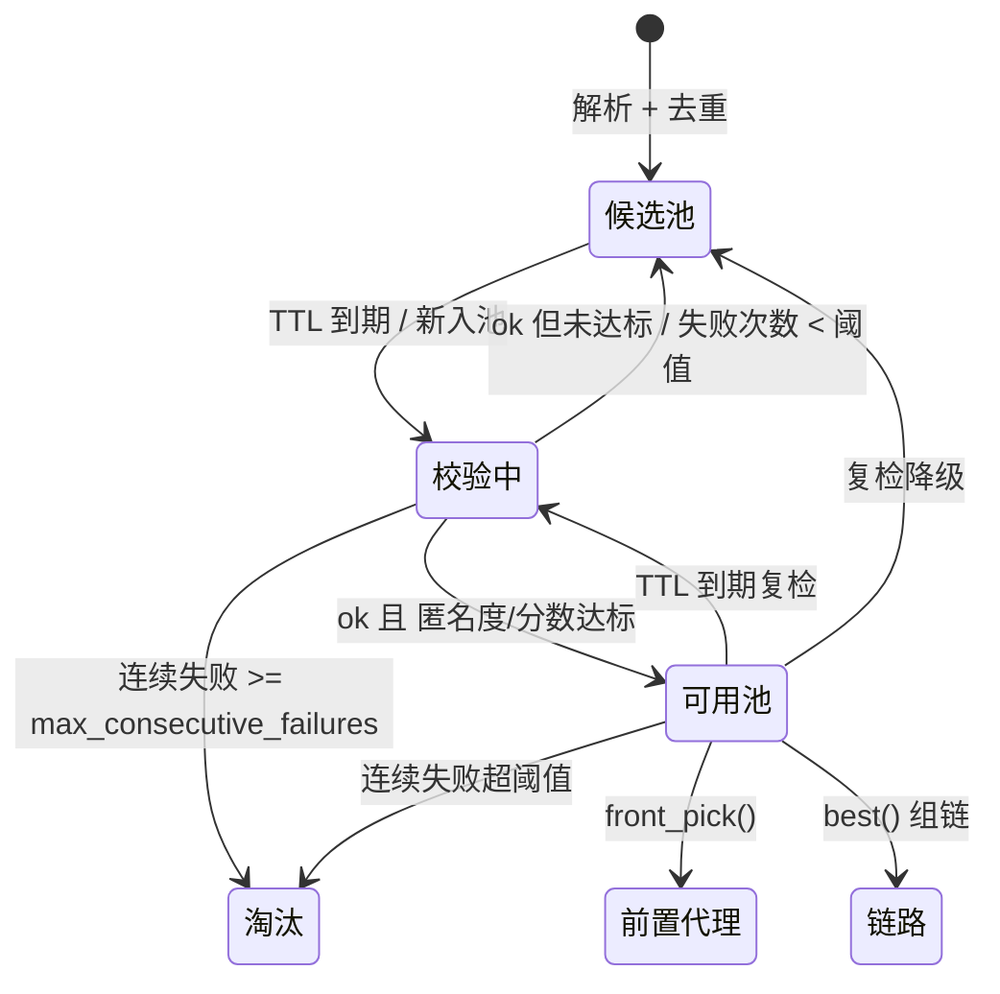

# 02 数据模型与双池

## 1. `ProxyNode` 契约

定义于 `anonchains/models/proxy_node.py`，`dataclass(slots=True)`，贯穿「源 → 解析 → 候选池 → 校验 → 可用池 → 链」。

| 字段 | 类型 | 敏感 | 说明 |
| --- | --- | --- | --- |
| `protocol` | `Protocol` | 否 | 协议枚举 |
| `host` | `str` | 否 | 规范化主机（小写、去括号等） |
| `port` | `int` | 否 | 1..65535 |
| `credential` | `dict \| None` | **是** | 口令、UUID、私钥等，落盘前由 Vault 封印 |
| `params` | `dict` | 否 | SNI / ALPN / network / cipher 等非敏感协议参数 |
| `raw` | `str \| None` | **是** | 原始分享链接或配置片段 |
| `latency_ms` | `float \| None` | 否 | 最近一次 echo 往返延迟 |
| `anonymity` | `Anonymity` | 否 | transparent / anonymous / elite / unknown |
| `country` | `str \| None` | 否 | 公开源提供的国家码 |
| `score` | `float` | 否 | 0..100 综合评分 |
| `success_count` / `fail_count` | `int` | 否 | 成功 / 失败累计 |
| `last_checked_at` | `float \| None` | 否 | 上次校验时间戳，用于 TTL 增量复检 |
| `source` | `str \| None` | 否 | 来源名，便于追溯与统计 |
| `first_seen_at` | `float` | 否 | 首次入池时间戳 |

关键行为：

- `stable_key()`：`stable_digest(protocol, host.lower(), port, canonical_value(credential))`。同端点不同凭证视为不同节点（订阅常见），去重组键为 O(1)。
- `summary()`：只输出 `protocol://host:port`，可安全用于日志。
- `to_dict(include_secrets=False)`：默认**不含** `credential` / `raw`；CLI 与 REST 均使用默认。
- `is_native`：`protocol in NATIVE_PROTOCOLS`。
- `__post_init__()`：枚举归一化、主机规范化、端口范围校验。

### 协议枚举

| 类别 | 协议 |
| --- | --- |
| 原生（Python 级联） | `http`、`https`、`socks4`、`socks5` |
| 外部核心 | `vless`、`vmess`、`ss`、`ssr`、`trojan`、`wireguard`、`hysteria2`、`tuic`、`anytls`、`mtproto` |
| 其它 | `clash`（容器格式）、`unknown` |

`EXTERNAL_PROTOCOLS = frozenset(Protocol) - NATIVE_PROTOCOLS - {UNKNOWN, CLASH}`。新增枚举值会自动落入外部协议集合，因此必须同步检查 `core_adapter/node_outbound.py` 是否可映射。

### 匿名度

`Anonymity` 排序：`unknown(0) < transparent(1) < anonymous(2) < elite(3)`。`validator.anonymity.classify()` 依据：

- 出口 IP 等于直连基线 IP，或响应体出现直连 IP → `transparent` 且判定无效；
- 出现 `X-Forwarded-For` / `Via` / `X-Real-IP` / `Forwarded` / `X-Proxy-Id` 泄漏头 → `anonymous`；
- 仅能解析到出口 IP 且无泄漏头 → `elite`；
- 其它 → `unknown`。

`compute_score()` 从 100 分起，按延迟最多扣 60、匿名度加/减分、成功次数加分（上限 10 次 × 0.5）、失败次数重罚（`min(70, fail_count * 12)`），最终裁剪到 0..100。

## 2. SQLite 持久化

`anonchains/pools/store.py` 的 `NodeStore`：每个池一个 WAL SQLite 文件，单连接 + `threading.RLock` 保护短临界区，避免 asyncio 并发写入造成锁竞争。表 `nodes`：

| 列 | 类型 | 说明 |
| --- | --- | --- |
| `key` | TEXT PRIMARY KEY | `stable_key()` |
| `protocol` / `host` / `port` | TEXT / TEXT / INTEGER | 非敏端点信息 |
| `sealed` | TEXT NULLABLE | Vault 封印后的 `{"credential":…, "raw":…}`（AAD 绑定 `key`），锁定时为 NULL |
| `params` | TEXT | JSON 非敏参数 |
| `latency_ms` / `score` | REAL | 测量与评分 |
| `anonymity` / `country` / `source` | TEXT | 分级与追溯 |
| `success_count` / `fail_count` | INTEGER | 统计 |
| `first_seen_at` / `last_checked_at` / `created_at` / `updated_at` | REAL | 时间戳 |

索引：`score DESC`、`last_checked_at`、`protocol`、`host`。写入使用 `INSERT ... ON CONFLICT(key) DO UPDATE` + `executemany` 批量事务；`sealed` 使用 `COALESCE(excluded.sealed, nodes.sealed)`，保证 Vault 锁定时的空值不会覆盖已有密文。

**安全不变量**：Vault 未解锁 / 禁用 / 不可用 / 未初始化时，`seal_dict()` 返回 `None`，敏感列留 NULL，**绝不写明文**；非敏元数据仍可入库，节点在解锁前无法恢复凭证。数据库文件中可直接检索的明文只有端点与统计信息。

## 3. 双池状态机

### 候选池 `CandidatePool`

`add()` 去重合并并保留来源；`take_stale(limit, ttl)` 取待检节点；`take_unchecked()` 取从未校验节点；`sample()` 取样展示；`remove()` / `clear()` / `count()` / `stats()`。

### 可用池 `VerifiedPool`

`upsert()` 批量升级；`best(limit)` 按评分排序供组链；`take_stale()` TTL 复检；`demote()` / `remove()`；`pick()` 与 `front_pick()`。`FrontProxyProvider` 只选原生 HTTP/HTTPS 高分节点，支持 `exclude_host` 与轮询/随机偏置，避免采集请求经过正在抓取的同一主机。

### 调度决策 `Scheduler._apply_results()`

- `result.ok` 且 `anonymity_rank >= min_anonymity` 且 `score >= min_score` → 升入可用池；
- `result.ok` 但未达门槛 → 回写候选池；
- `not result.ok` 且 `fail_count < max_consecutive_failures` → 从可用池移除并回写候选池（保留失败计数）；
- `not result.ok` 且 `fail_count >= max_consecutive_failures` → 从两个池删除。

`_collect_stale()` 从候选池取 `validator.concurrency * 4` 个、可用池取一半，按 `stable_key()` 合并去重，实现**增量复检**而非全量重扫。

## 4. 池文件与运维

| 文件 | 生成时机 | 说明 |
| --- | --- | --- |
| `pools/candidate/candidate.db` | 首次抓取 | 候选池（含 `-wal` / `-shm`） |
| `pools/verified/verified.db` | 首次升级 | 可用池 |
| `pools/.vault` | 主菜单 `7 -> 2` 初始化 | 密文头 + 被封装的 DEK + 验证器 |
| `pools/.gateway_token` | Vault 解锁时 | 被封印的 REST token（Vault 锁定时不落盘） |

备份须同时备份两个 `.db`、`.vault` 与主口令（分开保管）；只备份数据库无法恢复凭证。清空池：停止程序后删除 `.db`；删除 `.vault` 会永久丢失已封印凭证。所有运行时文件均在 `.gitignore` 中。

## 5. 新增字段的检查清单

1. `ProxyNode` 增字段 + `to_dict()` / `from_dict()`；
2. 判断是否敏感：是 → 加入 `store.py` 的 `sealed` 载荷；否 → 新增列与 `_UPSERT`；
3. 解析器是否需要填充；校验器是否需要更新；
4. `docs/02` 表格与 `docs/09` 的 REST 输出说明；
5. 新增离线用例（不联网）。
